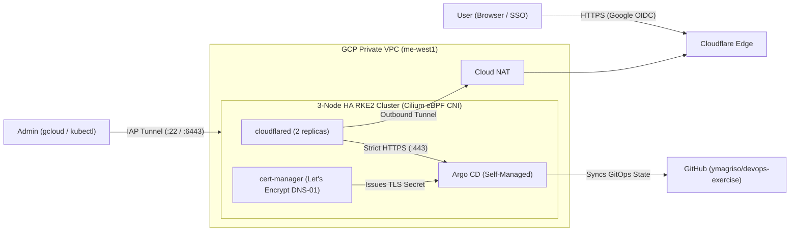

# High Availability RKE2 Cluster on Google Cloud (GitOps & Free Trial Setup)

This repository contains the configuration, GitOps manifests, and step-by-step documentation for deploying a highly available, 3-node **RKE2 (Kubernetes)** cluster on **Google Cloud Platform (GCP)**.

The architecture is optimized to run within the **$300 GCP Free Trial** by provisioning private VMs (`--network-interface=no-address`), using **Identity-Aware Proxy (IAP)** for administrative access, **Cloud NAT** for outbound internet, **Cilium** (eBPF) as the CNI, **`cert-manager`** (Let's Encrypt DNS-01) for automated HTTPS certificates, and **self-managed Argo CD** exposed via **Cloudflare Tunnel (`cloudflared`)** with **Google OIDC** authentication.

---

## Architecture Overview



---

## Documentation Guides

| # | Guide | Description |
| :--- | :--- | :--- |
| **1** | [**Architecture & Regional Cost Comparison**](docs/01-architecture-and-costs.md) | Why **RKE2** and **Cilium CNI** were chosen, **Single vs. Multiple Namespace** strategy (pros/cons & recommendations), GCP "Always Free" vs. $300 Free Trial credits, and regional cost/latency comparison (`me-west1` vs. US/EU). |
| **2** | [**GCP Infrastructure & RKE2 Cluster Setup**](docs/02-gcp-rke2-cluster-setup.md) | Provisioning the 3 private Ubuntu 24.04 VMs, IAP firewall rules, Cloud NAT, bootstrapping the HA RKE2 + Cilium cluster, and local `kubectl` access. |
| **3** | [**`cert-manager` & Let's Encrypt (HTTPS)**](docs/03-cert-manager-letsencrypt.md) | Installing `cert-manager` via Helm and configuring `letsencrypt-staging` and `letsencrypt-prod` `ClusterIssuer` resources using Cloudflare DNS-01. |
| **4** | [**Argo CD GitOps, Cloudflare Tunnel & Google OIDC**](docs/04-argocd-cloudflare-oidc.md) | Deploying Argo CD, issuing its Let's Encrypt certificate, exposing it via Cloudflare Tunnel (`cloudflared`), bootstrapping the Root App-of-Apps, and enabling Google OIDC login. |
| **5** | [**Cluster Operations & Cost Management**](docs/05-operations-and-cleanup.md) | Stopping and starting the cluster VMs to conserve Free Trial credits, checking node status, and full cluster teardown. |

---

## Repository Structure

```text
devops-exercise/
├── README.md                                           # Overview, architecture & documentation index
├── docs/                                               # Modular step-by-step guides
│   ├── 01-architecture-and-costs.md
│   ├── 02-gcp-rke2-cluster-setup.md
│   ├── 03-cert-manager-letsencrypt.md
│   ├── 04-argocd-cloudflare-oidc.md
│   └── 05-operations-and-cleanup.md
├── cert-manager/
│   ├── values.yaml                                     # Helm values for jetstack/cert-manager
│   └── cluster-issuers.yaml                            # Let's Encrypt Staging & Prod ClusterIssuers (DNS-01)
└── argocd/
    ├── values.yaml                                     # Helm values for argo/argo-cd (Google OIDC enabled)
    ├── certificate.yaml                                # Let's Encrypt Certificate for argocd-server-tls
    ├── bootstrap/
    │   └── root-app.yaml                               # Root App-of-Apps watching argocd/apps/
    └── apps/
        ├── argocd.yaml                                 # Argo CD self-management Application
        ├── cert-manager.yaml                           # cert-manager GitOps Application
        ├── cloudflared.yaml                            # Cloudflare Tunnel GitOps Application
        └── workloads/
            └── cloudflared/
                ├── namespace.yaml
                └── deployment.yaml
```
