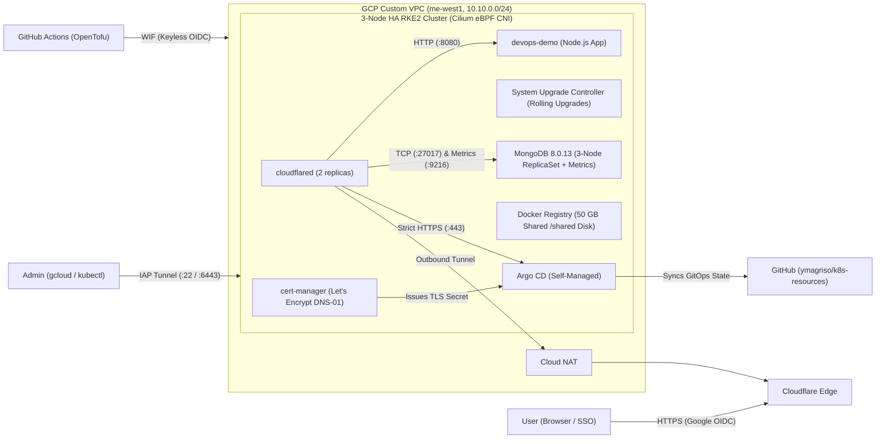

# High Availability RKE2 Cluster on Google Cloud (GitOps, OpenTofu & Free Trial Setup)

This repository contains the configuration, GitOps manifests, OpenTofu infrastructure-as-code declarations, and step-by-step documentation for deploying a highly available, 3-node **RKE2 (Kubernetes)** cluster on **Google Cloud Platform (GCP)**.

The architecture is optimized to run within the **$300 GCP Free Trial** by provisioning private VMs (`--network-interface=no-address`) in a dedicated **Custom VPC**, using **Identity-Aware Proxy (IAP)** for administrative access, **Cloud NAT** for outbound internet, **Cilium** (eBPF) as the CNI, **`cert-manager`** (Let's Encrypt DNS-01) for automated HTTPS certificates, and **self-managed Argo CD** exposed via **Cloudflare Tunnel (`cloudflared`)** with **Google OIDC** authentication.

---

## Architecture Overview



---

## Documentation Guides

| # | Guide | Description |
| :--- | :--- | :--- |
| **1** | [**Architecture & Regional Cost Comparison**](docs/01-architecture-and-costs.md) | Why **RKE2** and **Cilium CNI** were chosen, **Single vs. Multiple Namespace** strategy (pros/cons & recommendations), GCP "Always Free" vs. $300 Free Trial credits, and regional cost/latency comparison (`me-west1` vs. US/EU). |
| **2** | [**GCP Infrastructure & RKE2 Cluster Setup**](docs/02-gcp-rke2-cluster-setup.md) | Automated provisioning with **OpenTofu** & **GitHub Actions** (Dedicated Custom VPC, Cloud NAT, IAP firewalls, fixed node IPs, and automated RKE2 + Cilium bootstrap) alongside manual `gcloud` walkthrough. |
| **3** | [**`cert-manager` & Let's Encrypt (HTTPS)**](docs/03-cert-manager-letsencrypt.md) | Installing `cert-manager` via Helm and configuring `letsencrypt-staging` and `letsencrypt-prod` `ClusterIssuer` resources using Cloudflare DNS-01. |
| **4** | [**Argo CD GitOps, Cloudflare Tunnel & Google OIDC**](docs/04-argocd-cloudflare-oidc.md) | Deploying Argo CD, issuing its Let's Encrypt certificate, exposing it via Cloudflare Tunnel (`cloudflared`), bootstrapping the Root App-of-Apps, and enabling Google OIDC login. |
| **5** | [**MongoDB ReplicaSet (`8.0.13`) & Prometheus Metrics**](docs/05-mongodb-replicaset-and-metrics.md) | Deploying a 3-node Bitnami MongoDB `8.0.13` ReplicaSet via Argo CD with explicit resource limits, Prometheus metrics exporter (`:9216`), and external access via Cloudflare Tunnel (`:27017`). |
| **6** | [**Cluster Operations, Renovate & Cost Management**](docs/06-operations-and-cleanup.md) | Automated Helm, Docker & OpenTofu updates with **Mend Renovate** (with 3-day/7-day cooldown), zero-downtime rolling RKE2 upgrades via **System Upgrade Controller (SUC)**, stopping/starting cluster VMs to conserve credits, and automated single-click teardown. |

---

## Repository Structure

```text
k8s-resources/
├── README.md                                           # Overview, architecture & documentation index
├── renovate.json                                       # Mend Renovate configuration (Helm, K8s, Docker & OpenTofu rules)
├── .github/
│   └── workflows/
│       ├── tofu-apply.yml                              # OpenTofu plan/apply & zero-touch cluster bootstrap
│       ├── tofu-destroy.yml                            # OpenTofu safe teardown (requires "DESTROY" input)
│       └── cloudflare-tunnel.yml                       # Declarative Cloudflare Tunnel routes & DNS CNAME automation
├── tofu/                                               # Declarative GCP Infrastructure as Code
│   ├── versions.tf                                     # OpenTofu & Google/Random provider constraints
│   ├── providers.tf                                    # Provider configuration
│   ├── variables.tf                                    # Parameterized GCP variables
│   ├── terraform.tfvars.example                        # Example variables file
│   ├── vpc.tf                                          # Custom VPC, subnet, Cloud Router & Cloud NAT
│   ├── firewall.tf                                     # IAP ingress & intra-cluster firewall rules
│   ├── compute.tf                                      # Dedicated Service Account & 3x private VMs
│   ├── startup.sh.tftpl                                # Unified RKE2 + Cilium automated bootstrap script
│   ├── outputs.tf                                      # Node IPs, helper IAP and kubeconfig commands
│   └── cloudflare/                                     # Declarative Cloudflare Tunnel routes & DNS CNAME stack
│       ├── routes.yaml                                 # Ordered list of tunnel ingress routes
│       ├── main.tf                                     # Tunnel config & proxied CNAME records
│       ├── versions.tf                                 # OpenTofu & Cloudflare provider constraints
│       ├── backend.tf                                  # GCS remote state backend (prefix: cloudflare-tunnel)
│       ├── providers.tf                                # Cloudflare provider configuration
│       ├── variables.tf                                # Account ID, Tunnel ID & private domain inputs
│       ├── outputs.tf                                  # Sensitive zone & hostname outputs
│       └── terraform.tfvars.example                    # Example variables file for local runs
├── docs/                                               # Modular step-by-step guides
│   ├── 01-architecture-and-costs.md
│   ├── 02-gcp-rke2-cluster-setup.md
│   ├── 03-cert-manager-letsencrypt.md
│   ├── 04-argocd-cloudflare-oidc.md
│   ├── 05-mongodb-replicaset-and-metrics.md
│   └── 06-operations-and-cleanup.md
├── cert-manager/
│   ├── values.yaml                                     # Helm values for jetstack/cert-manager
│   └── cluster-issuers.yaml                            # Let's Encrypt Staging & Prod ClusterIssuers (DNS-01)
├── mongodb/
│   └── values.yaml                                     # Helm values for bitnami/mongodb (8.0.13 ReplicaSet + Metrics)
└── argocd/
    ├── values.yaml                                     # Helm values for argo/argo-cd (Google OIDC enabled)
    ├── certificate.yaml                                # Let's Encrypt Certificate for argocd-server-tls
    ├── certificate-registry.yaml                       # Let's Encrypt Certificate for docker-registry-tls
    ├── bootstrap/
    │   └── root-app.yaml                               # Root App-of-Apps watching argocd/apps/
    └── apps/
        ├── argocd.yaml                                 # Argo CD self-management Application
        ├── cert-manager.yaml                           # cert-manager GitOps Application
        ├── cloudflared.yaml                            # Cloudflare Tunnel GitOps Application
        ├── mongodb.yaml                                # Bitnami MongoDB ReplicaSet GitOps Application
        ├── system-upgrade-controller.yaml              # Rancher System Upgrade Controller Application
        ├── rke2-upgrade-plans.yaml                     # RKE2 automated upgrade Plans Application
        ├── devops-demo.yaml                            # sample-nodejs OCI Helm GitOps Application
        ├── docker-registry.yaml                        # Docker Registry GitOps Application
        └── workloads/
            ├── cloudflared/
            │   ├── namespace.yaml
            │   └── deployment.yaml
            ├── docker-registry/
            │   ├── namespace.yaml
            │   ├── service.yaml                        # Exposes port 443 (HTTPS) & 5000
            │   └── deployment.yaml                     # Native TLS (Let's Encrypt), htpasswd auth, storage on /shared/docker-registry
            ├── system-upgrade-controller/
            │   └── kustomization.yaml                  # Upstream pinned SUC manifests & CRDs
            └── rke2-upgrade-plans/
                └── plans.yaml                          # Server & Agent rolling upgrade Plan definitions
```
