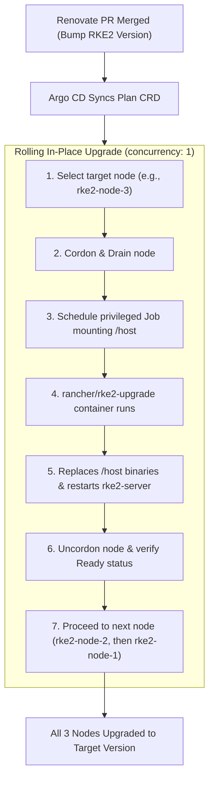

[← Back to Main README](../README.md) | [← Previous: MongoDB ReplicaSet & Metrics](05-mongodb-replicaset-and-metrics.md)

---

# 6. Cluster Operations, Dependency Automation & Cost Management

- [Automated Dependency Updates with Mend Renovate](#automated-dependency-updates-with-mend-renovate)
  - [Tracked Managers & Files](#tracked-managers--files)
  - [Cooldown (`minimumReleaseAge`) & Rate-Limiting Strategy](#cooldown-minimumreleaseage--rate-limiting-strategy)
- [Container Image & IaC Vulnerability Scanning (Trivy)](#container-image--iac-vulnerability-scanning-trivy)
  - [Execution Approaches Compared](#execution-approaches-compared)
  - [Scanner Alternatives Compared](#scanner-alternatives-compared)
  - [How the Trivy Workflow Operates](#how-the-trivy-workflow-operates)
  - [Interaction with CodeQL Merge Protection & Enabling PR Blocking](#interaction-with-codeql-merge-protection--enabling-pr-blocking)
- [Automated In-Place RKE2 Upgrades (System Upgrade Controller)](#automated-in-place-rke2-upgrades-system-upgrade-controller)
  - [Architecture & Rolling Upgrade Workflow](#architecture--rolling-upgrade-workflow)
  - [Renovate Coordination & Single-Minor Upgrade Guard](#renovate-coordination--single-minor-upgrade-guard)
  - [OpenTofu In-Place VM Metadata & Safety Guardrail](#opentofu-in-place-vm-metadata--safety-guardrail)
- [TLS Certificate Persistence & ACME Rate-Limit Protection](#tls-certificate-persistence--acme-rate-limit-protection)
- [Automated & Manual Instance Power Management (Cost Conservation)](#automated--manual-instance-power-management-cost-conservation)
  - [Nightly Auto-Shutdown & On-Demand Workflow](#nightly-auto-shutdown--on-demand-workflow)
  - [Stop the Instances via CLI](#stop-the-instances-via-cli)
  - [Start the Instances via CLI](#start-the-instances-via-cli)
  - [Check Instance Status](#check-instance-status)
- [Delete the Cluster (Full Cleanup)](#delete-the-cluster-full-cleanup)
  - [Method A: Automated Teardown via GitHub Actions (Recommended)](#method-a-automated-teardown-via-github-actions-recommended)
  - [Method B: Teardown via OpenTofu CLI](#method-b-teardown-via-opentofu-cli)
  - [Method C: Manual Teardown via gcloud CLI](#method-c-manual-teardown-via-gcloud-cli)

---

## Automated Dependency Updates with Mend Renovate

This repository uses the [**Mend Renovate**](https://developer.mend.io) GitHub App configured via [`renovate.json`](../renovate.json) to automatically detect and open Pull Requests for new **RKE2 Kubernetes versions**, **Helm chart versions**, **Docker container image tags**, and **OpenTofu provider versions**. Because Argo CD is configured with automated sync (`automated: true`), merging a Renovate PR into `main` automatically rolls out the upgrade to the cluster.

### Tracked Managers & Files

| Renovate Manager | Pattern (`managerFilePatterns`) | Tracked Dependencies |
| :--- | :--- | :--- |
| **`terraform`** | `/^tofu/.*\.tf$/` | • OpenTofu required version<br>• `hashicorp/google` provider<br>• `hashicorp/random` provider<br>• `cloudflare/cloudflare` provider in [`tofu/cloudflare/versions.tf`](../tofu/cloudflare/versions.tf) (all routed to `registry.opentofu.org`) |
| **`custom.regex` (RKE2)** | `/^tofu/variables\.tf$/`<br>`/^argocd/apps/workloads/rke2-upgrade-plans/.+\.ya?ml$/` | • `rancher/rke2` GitHub releases (synchronized across both OpenTofu variable defaults and runtime SUC `Plan` CRDs) |
| **`custom.regex` (SUC)** | `/^argocd/apps/workloads/system-upgrade-controller/kustomization\.ya?ml$/` | • `rancher/system-upgrade-controller` GitHub releases |
| **`argocd`** | `/^argocd/(apps\|bootstrap)/[^/]+\.ya?ml$/` | • `argo-cd` Helm chart in [`argocd/apps/argocd.yaml`](../argocd/apps/argocd.yaml)<br>• `cert-manager` Helm chart in [`argocd/apps/cert-manager.yaml`](../argocd/apps/cert-manager.yaml)<br>• `mongodb` OCI Helm chart in [`argocd/apps/mongodb.yaml`](../argocd/apps/mongodb.yaml) |
| **`kubernetes`** | `/^argocd/apps/workloads/.+\.ya?ml$/` | • `cloudflare/cloudflared` image in [`argocd/apps/workloads/cloudflared/deployment.yaml`](../argocd/apps/workloads/cloudflared/deployment.yaml) |
| **`helm-values`** | `/(^\|/)values\.ya?ml$/` | • `bitnamilegacy/mongodb` & `bitnamilegacy/mongodb-exporter` images in [`mongodb/values.yaml`](../mongodb/values.yaml) |
| **`github-actions`** | `.github/workflows/*.ya?ml` | • GitHub Actions action versions (`setup-opentofu`, `auth`, `setup-gcloud`) |

### Cooldown (`minimumReleaseAge`) & Rate-Limiting Strategy

To protect the GitOps cluster against supply-chain compromises and unstable "Day-0" upstream releases:
* **3-Day Default Cooldown (`"minimumReleaseAge": "3 days"`):** Patch and minor Helm chart, RKE2, or Docker image updates must soak upstream for at least 3 days before Renovate opens a PR.
* **7-Day Major Release Cooldown (`matchUpdateTypes: ["major"]`):** Major version upgrades require a 7-day cooldown window to allow early upstream hotfixes (`.1` / `.2`) to settle.
* **One Minor Version at a Time for Kubernetes (`separateMultipleMinor: true`):** Kubernetes only supports sequential minor version upgrades ($1.35 \rightarrow 1.36 \rightarrow 1.37$). Renovate is configured with `separateMultipleMinor: true` for `rancher/rke2` to ensure a dedicated PR is opened per minor series rather than skipping minor releases.
* **Pinned Major Series for MongoDB (`registry-1.docker.io/bitnamicharts/mongodb`):** Major chart updates (`17.x+`, which target MongoDB `8.2`/`9.0` and `:latest` tags) are disabled (`enabled: false`) so the chart remains aligned with the pinned MongoDB `8.0.13` (`16.x`) release.
* **PR Rate Limits (`prHourlyLimit: 2`, `prConcurrentLimit: 5`):** Prevents PR spam while automatically tagging PRs with `rke2`, `opentofu`, `helm`, `docker`, and `dependencies` labels.

---

## Container Image & IaC Vulnerability Scanning (Trivy)

This repository uses [**Aqua Security Trivy**](https://trivy.dev/) in [`.github/workflows/trivy-scan.yml`](../.github/workflows/trivy-scan.yml) to scan both **container images** (across static Kubernetes manifests, Kustomize overlays, rendered Helm charts, and the internal private Docker Registry) and **Infrastructure-as-Code (IaC)** declarations (`tofu/`, `argocd/`, `cert-manager/`, `mongodb/`).

### Execution Approaches Compared

Before selecting GitHub Actions as the execution environment, three architectural approaches were evaluated against the constraints of this 3-node (`e2-standard-2`, 8 GB RAM) cluster:

| Dimension | Option A: GitHub Actions Workflow *(Selected)* | Option B: In-Cluster `trivy-operator` (Argo CD) | Option C: App Build Pipeline (`sample-nodejs` CI) |
| :--- | :--- | :--- | :--- |
| **Detection Stage** | **Shift-Left (Pre-Merge):** Scans Renovate and manual PRs *before* they merge to `main`, plus daily scheduled runs | **Runtime (Post-Deploy):** Scans pods only *after* they are deployed in the cluster | **Build Time:** Scans first-party application images before `docker push` |
| **RKE2 Node RAM / CPU Impact** | **Zero (`0 MB`)** — runs entirely on GitHub-hosted runners | **High (~500 MB–1.5 GB RAM spikes)** per scan job when unpacking image layers + etcd storage for `VulnerabilityReport` CRDs | **Zero (`0 MB`)** — runs on GitHub-hosted runners |
| **Works During Nightly VM Shutdown (`23:00–06:00`)?** | **Yes** for all public, Kustomize, and Helm images; gracefully skips private registry when cluster is powered off | **No** — requires VMs running and triggers a scan storm when VMs boot up | **Yes** for builds; requires cluster online to push to `registry.<domain>` |
| **Third-Party Helm & Infra Coverage** | **Full** (`argo-cd`, `cert-manager`, `mongodb`, `cloudflared`, `registry`, `rke2-upgrade`, `SUC`) | **Full** (including `kube-system` pods) | **None** (only scans first-party app code) |
| **Visibility & UI** | Native GitHub PR Job Summaries & **Security → Code scanning** (SARIF) | Requires `kubectl get vulnerabilityreports` or deploying an additional dashboard | App repository PR checks |

### Scanner Alternatives Compared

| Tool | Maintainer | Capabilities | Pros vs. Trivy | Cons vs. Trivy |
| :--- | :--- | :--- | :--- | :--- |
| **Trivy** *(Selected)* | Aqua Security (CNCF) | Container images (OS + language packages), K8s YAML, Helm charts, OpenTofu (`.tf`), Secrets, SBOMs | **Single unified scanner** covering both container CVEs and OpenTofu/Kubernetes misconfigurations; native SARIF output | ~60 MB vulnerability DB download (cached via `aquasecurity/setup-trivy`) |
| **Grype + Syft** | Anchore | Container images & filesystems (SBOM + CVEs) | Fast scanning and clean SBOM separation | **Does not scan OpenTofu (`.tf`) or Kubernetes YAML misconfigurations** |
| **Kubescape** | ARMO (CNCF) | Kubernetes posture (NSA/CISA, CIS) + image scanning | Strong Kubernetes RBAC/posture compliance rules | Focused on K8s posture rather than standalone OpenTofu + container CVE scanning |
| **Docker Scout / Snyk** | Docker / Snyk | Container images & dependencies | Polished SaaS UI | Requires external SaaS accounts/tokens with strict free-tier repository/scan limits |

### How the Trivy Workflow Operates

The workflow ([`.github/workflows/trivy-scan.yml`](../.github/workflows/trivy-scan.yml)) runs on every `pull_request`, `push` to `main`, daily at `10:00` (`Asia/Jerusalem`, when the cluster VMs are typically awake during daytime work), and via manual `workflow_dispatch`:

1. **IaC & Kubernetes Manifest Scan (`trivy config`):**
   * Scans `tofu/`, `argocd/`, `cert-manager/`, and `mongodb/` for `HIGH` and `CRITICAL` security misconfigurations.
   * Renders a Markdown summary table into the GitHub Actions Job Summary (`$GITHUB_STEP_SUMMARY`).
2. **Multi-Source Container Image Discovery:**
   * **Static Workloads (`argocd/apps/workloads/**`):** Extracts images such as `cloudflare/cloudflared`, `registry`, and resolves `rancher/rke2-upgrade:<version>` from the System Upgrade Controller `Plan` CRDs.
   * **Kustomize Overlays:** Runs `kubectl kustomize argocd/apps/workloads/system-upgrade-controller` to extract the pinned `rancher/system-upgrade-controller` image.
   * **Helm Charts (`argocd/apps/*.yaml`):** Parses the `Application` manifests for `argocd`, `cert-manager`, and `mongodb`, runs `helm template` with each component's `values.yaml`, and extracts all rendered container images (`quay.io/argoproj/argocd`, `ecr-public.aws.com/docker/library/redis`, `quay.io/jetstack/cert-manager-*`, `bitnamilegacy/mongodb`, `bitnamilegacy/mongodb-exporter`).
   * **Private Docker Registry (`registry.<CUSTOM_DOMAIN>`):** Pings `https://registry.<CUSTOM_DOMAIN>/v2/`. When the RKE2 cluster is online, it authenticates with `DOCKER_REGISTRY_USERNAME` / `DOCKER_REGISTRY_PASSWORD`, resolves `argocd/apps/devops-demo.yaml`, and queries `/v2/_catalog` (excluding `charts/*` OCI Helm chart artifacts) to scan all private container images. If the cluster VMs are stopped (e.g., during the `23:00–06:00` nightly shutdown window), it records that the private registry is offline and skips private images without failing the workflow.
3. **Container Image Vulnerability Scan (`trivy image`):**
   * Scans every discovered image for `HIGH` and `CRITICAL` OS and library CVEs (`--pkg-types os,library --scanners vuln`).
   * Publishes an overview table (`Critical`, `High`, `Fixable`, `Status`) and expandable `<details>` CVE breakdowns per image to the GitHub Actions Job Summary.

### Interaction with CodeQL Merge Protection & Enabling PR Blocking

Because **GitHub Code Scanning (CodeQL)** is enabled on this repository and configured to block PRs on security errors:
* Uploading a SARIF file (`github/codeql-action/upload-sarif`) during a `pull_request` run feeds third-party findings into the **same Code Scanning merge protection gate**, which can block PRs due to unfixed upstream base-image CVEs.
* **Default Report-Only Mode (Current):**
  * On `pull_request` events, Trivy runs with `--exit-code 0` and writes full Markdown tables to the **GitHub Actions Job Summary** without uploading SARIF, guaranteeing PRs are never blocked by upstream image CVEs.
  * On `push` to `main`, `schedule`, and `workflow_dispatch`, Trivy uploads SARIF (`category: trivy-iac-config`) to populate the **Security → Code scanning** tab alongside CodeQL.
* **How to Enable PR Blocking Later:**
  * **On-Demand Testing:** Trigger **Actions → Trivy Security Scan (Images & IaC) → Run workflow** and check `fail_on_critical: true`.
  * **Permanent Enforcement on PRs:** Set `FAIL_ON_CRITICAL: "true"` (or remove `if: github.event_name != 'pull_request'` on the SARIF upload step) in [`.github/workflows/trivy-scan.yml`](../.github/workflows/trivy-scan.yml) to fail PR checks whenever fixable `CRITICAL` vulnerabilities or IaC misconfigurations are introduced.

---

## Automated In-Place RKE2 Upgrades (System Upgrade Controller)

In standard GCP VM deployments, updating the RKE2 version in a VM startup script only applies when a machine boots. To provide **true zero-downtime, automated in-place upgrades** of running Kubernetes nodes, this repository deploys Rancher's [**System Upgrade Controller (SUC)**](https://github.com/rancher/system-upgrade-controller).

### Architecture & Rolling Upgrade Workflow

The System Upgrade Controller is deployed into the `system-upgrade` namespace via Argo CD using pinned upstream Kustomize manifests ([`argocd/apps/workloads/system-upgrade-controller/`](../argocd/apps/workloads/system-upgrade-controller/)):



#### Defined Upgrade Plans ([`argocd/apps/workloads/rke2-upgrade-plans/plans.yaml`](../argocd/apps/workloads/rke2-upgrade-plans/plans.yaml)):
1. **`rke2-server` Plan:**
   - Targets control-plane server nodes (`node-role.kubernetes.io/control-plane: "true"`).
   - Set to `concurrency: 1` so only one server node is cordoned and upgraded at any time, maintaining etcd quorum and control-plane availability.
   - Executes the container image `rancher/rke2-upgrade` with host root mounted at `/host`.
2. **`rke2-agent` Plan:**
   - Targets worker/agent nodes (currently a no-op until worker nodes are added).
   - Uses `prepare` to ensure worker nodes only upgrade after the `rke2-server` plan has fully completed.

### Renovate Coordination & Single-Minor Upgrade Guard

Because the RKE2 version is declared in two places:
1. [`tofu/variables.tf`](../tofu/variables.tf) (used by OpenTofu when provisioning **new** VMs from scratch)
2. [`argocd/apps/workloads/rke2-upgrade-plans/plans.yaml`](../argocd/apps/workloads/rke2-upgrade-plans/plans.yaml) (used by SUC to upgrade **existing running** nodes)

[`renovate.json`](../renovate.json) defines custom regex managers with identical package names (`depName: "rancher/rke2"`). Renovate automatically bundles both changes into a **single Pull Request**. Merging the PR updates both the baseline bootstrap configuration and triggers Argo CD to execute the rolling upgrade immediately.

### OpenTofu In-Place VM Metadata & Safety Guardrail

In OpenTofu / Terraform Google provider:
* **The Risk of `metadata_startup_script`:** Setting `metadata_startup_script` forces VM replacement (`ForceNew`). Changing the version string would destroy and recreate all 3 VMs simultaneously, wiping the boot disks and etcd quorum.
* **The In-Place Fix:** In [`tofu/compute.tf`](../tofu/compute.tf), startup scripts are configured under the generic `metadata` map:
  ```hcl
  metadata = {
    startup-script = templatefile("${path.module}/startup.sh.tftpl", { ... })
  }
  ```
  In GCP, changing `metadata` is strictly an in-place update (`0 destroyed`).
* **CI Replacement Guardrail:** In [`.github/workflows/tofu-apply.yml`](../.github/workflows/tofu-apply.yml), every pipeline run performs `tofu plan -out=tfplan` and inspects the plan JSON:
  ```bash
  REPLACED=$(tofu show -json tfplan | jq -r '.resource_changes[]
    | select(.type == "google_compute_instance")
    | select(.change.actions | index("delete"))
    | "\(.address): \(.change.actions | join("/"))"')
  if [ -n "$REPLACED" ]; then
    # Refuses execution and fails the workflow unless explicitly authorized
  fi
  ```
  Any accidental attempt to replace or delete cluster VM instances is caught and blocked before `tofu apply` can execute. To explicitly allow VM replacements, the workflow must be run manually via `workflow_dispatch` with `allow_node_replacement: true`.

---

## TLS Certificate Persistence & ACME Rate-Limit Protection

To support frequent cluster destroy and recreate cycles without running into Let's Encrypt's production rate limits (**5 duplicate certificates per exact domain name per week**):
1. **Multi-Identifier SAN:** [`argocd/certificate.yaml`](../argocd/certificate.yaml) specifies both `argocd.<domain>` and `*.argocd.<domain>`.
2. **Encrypted State Bucket Caching:** During cluster bootstrapping in [`.github/workflows/tofu-apply.yml`](../.github/workflows/tofu-apply.yml), the workflow checks for a previously issued TLS Secret in Google Cloud Storage:
   ```bash
   CERT_CACHE_URI="gs://${PROJECT_ID}-tofu-state/certs/argocd-server-tls.json"
   ```
   If a certificate was previously generated, it is restored into Kubernetes before applying `Certificate` manifests. After issuance, the valid certificate secret is exported and cached back to GCS, ensuring zero downtime and zero wasted ACME quota on rebuilds.

---

## Automated & Manual Instance Power Management (Cost Conservation)

To stretch your $300 GCP Free Trial, the cluster VMs are automatically stopped overnight and can also be controlled on demand via GitHub Actions or the `gcloud` CLI.

### Nightly Auto-Shutdown & On-Demand Workflow

1. **Nightly Shutdown & Manual Toggle ([`.github/workflows/stop-rke2-vms.yml`](../.github/workflows/stop-rke2-vms.yml)):**
   * Runs every hour from **`23:00` to `06:00` (`Asia/Jerusalem`)** and stops any `RUNNING` `rke2-node-*` VMs automatically.
   * Can also be triggered manually from **Actions → RKE2 VMs Power Management → Run workflow** with `action: stop` or `action: start`.
2. **Auto-Start on Merge to `main` ([`.github/workflows/tofu-apply.yml`](../.github/workflows/tofu-apply.yml)):**
   * Whenever an infrastructure PR merges to `main`, `tofu-apply.yml` automatically starts any `TERMINATED` `rke2-node-*` VMs before running `tofu apply` and cluster bootstrap.

### Stop the Instances via CLI

```bash
gcloud compute instances stop rke2-node-1 rke2-node-2 rke2-node-3 --zone=me-west1-a
```

*Note: You will still incur a persistent disk storage fee (~$14.52/month total for 330 GB `pd-standard` in `me-west1`) while the VMs are stopped.*

### Start the Instances via CLI

Because `rke2-server.service` and `glusterd.service` are enabled with `systemctl enable` and GCP preserves each VM's internal IP address across stops/starts, starting the instances automatically brings the RKE2 cluster, 3-node GlusterFS `/shared` volume, `cert-manager`, Argo CD, and the Cloudflare Tunnel back online:

```bash
gcloud compute instances start rke2-node-1 rke2-node-2 rke2-node-3 --zone=me-west1-a
```

Once the VMs are running, re-open the IAP port-forwarding tunnel from [Guide 2: Step 5](02-gcp-rke2-cluster-setup.md#connecting-to-the-cluster-with-local-kubectl) if you want local `kubectl` access (the Argo CD Web UI at `https://argocd.<your-domain>` will reconnect automatically via `cloudflared`).

### Check Instance Status

Verify whether the nodes are `RUNNING` or `TERMINATED`:

```bash
gcloud compute instances list --filter="name~'^rke2-node-'"
```

---

## Delete the Cluster (Full Cleanup)

When you are done testing and want to ensure **zero charges** continue against your free trial, tear down the infrastructure using one of the following methods:

### Method A: Automated Teardown via GitHub Actions (Recommended)

1. Open your repository on GitHub and click the **Actions** tab.
2. Select the **OpenTofu Teardown (Destroy Cluster)** workflow.
3. Click **Run workflow**.
4. In the confirmation prompt, enter `DESTROY` and click run.
5. OpenTofu will permanently destroy all 3 VMs, persistent disks, Cloud NAT, Cloud Router, firewall rules, and the Custom VPC.

### Method B: Teardown via OpenTofu CLI

If you manage resources locally with the OpenTofu CLI:

```bash
cd tofu
tofu destroy
```

### Method C: Manual Teardown via gcloud CLI

If you provisioned the cluster using manual `gcloud` commands:

```bash
# Delete the 3 VMs and their attached boot disks
gcloud compute instances delete rke2-node-1 rke2-node-2 rke2-node-3 --zone=me-west1-a

# Delete the Cloud Router (and attached Cloud NAT configuration)
gcloud compute routers delete rke2-nat-router --region=me-west1

# Delete the IAP firewall rule
gcloud compute firewall-rules delete allow-ssh-from-iap
```

Verify that all disks have been removed:

```bash
gcloud compute disks list
```

---

[← Back to Main README](../README.md) | [← Previous: MongoDB ReplicaSet & Metrics](05-mongodb-replicaset-and-metrics.md)
